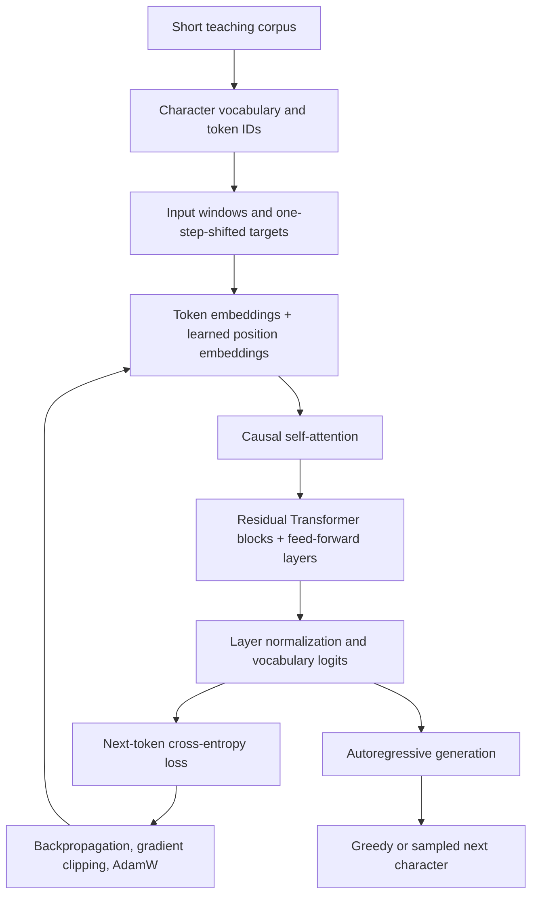

<h1 align="center">LLM Engineering Guide</h1>

<p align="center"><em>From language-model foundations to a working educational GPT and practical LLM engineering patterns.</em></p>

<p align="center">
  <a href="LLMs_From_Scratch_to_Advanced_Complete_Guide.ipynb">Open the notebook</a> ·
  <a href="Validation%20Report.md">Read the validation report</a>
</p>

<p align="center">
  
  
  
</p>

A visual, hands-on Jupyter course that connects the mathematics of language modeling to a small decoder-only GPT-style model, then explores selected methods used in modern LLM applications. The notebook combines explanations, formulas, diagrams, runnable PyTorch examples, and small local demonstrations.

> **Scope note — filename:** The project brief refers to `LLM Engineering Guide.ipynb`, but that exact filename was not present in the supplied workspace. The available notebook audited for this project is `LLMs_From_Scratch_to_Advanced_Complete_Guide.ipynb`. Links and commands below use the file that is actually available; no notebook was renamed.

## Quick navigation

- [What you will learn](#what-you-will-learn)
- [How the tiny GPT works](#how-the-tiny-gpt-works)
- [Implementation map](#implementation-map)
- [Notebook roadmap](#notebook-roadmap)
- [Getting started](#getting-started)
- [Optional integrations](#optional-integrations)
- [Saved checkpoint](#saved-checkpoint)
- [Validation](#validation)
- [Limitations](#limitations)
- [References](#references)

## What you will learn

| Learning area | Topics covered |
|---|---|
| **Foundations** | AI/ML/DL/NLP/LLM concepts, vectors and matrices, probability, entropy, cross-entropy, gradients, and optimization |
| **Text and attention** | Character and regex tokenization, toy BPE, embeddings, positional information, a RoPE illustration, Q/K/V, causal masks, multi-head attention, and decoder blocks |
| **Build a GPT** | Next-character targets, a small PyTorch decoder, loss inspection, gradients, checkpoint saving, attention visualization, and autoregressive sampling |
| **Modern LLM workflows** | Pretrained-model concepts, prompting, structured-output checks, instruction tuning, response-only loss masking, LoRA, QLoRA concepts, and preference alignment |
| **Retrieval and systems** | Local TF–IDF retrieval, synthetic retrieval metrics, restricted calculator/document-search tools, inference, evaluation, reliability, and safety |
| **Beyond a text-only Transformer** | Conceptual Transformer/Mamba comparisons, multimodal architecture concepts, and a synthetic image-patch projection example |
| **Consolidation** | Capstone project workflows, concept maps, formulas, glossary, troubleshooting guidance, and further reading |

## How the tiny GPT works

The core implementation is intentionally small enough to inspect. It starts with a short, lowercased teaching corpus and predicts the next character from preceding characters. The diagram describes the implemented training path rather than a production-scale LLM stack.



**What to notice:** the causal mask prevents a position from attending to future positions; the targets are shifted by one character; and generation feeds each sampled character back into the model's context. Training and generation are two paths through the same small model. The toy corpus is designed to make the mechanics visible, not to produce useful assistant responses.

## Implementation map

The notebook intentionally mixes runnable educational code with simplified explanations. Treat the depth of each section accordingly.

| Category | Present in the notebook | What it demonstrates—and what it does not |
|---|---|---|
| **Runnable core implementation** | Character-level data, `TinyGPT`, causal attention, decoder blocks, cross-entropy, backpropagation, AdamW training, loss traces, checkpoint save/load, and autoregressive generation | End-to-end mechanics of a small decoder-only model; not a general-purpose or pretrained LLM |
| **Runnable local demonstrations** | Mathematical and attention visualizations, toy BPE, a small LoRA wrapper, response-only loss masking, TF–IDF retrieval and toy retrieval metrics, structured-output checks, restricted local tools, and synthetic image patches | Useful for understanding concepts and tensor flow; examples use small or synthetic data rather than broad real-world evaluations |
| **Conceptual or simplified material** | QLoRA, RLHF/DPO, deployment optimization, Mamba and architecture trade-offs, and multimodal system design | Explanations, diagrams, and limited illustrative code—not complete end-to-end training or production systems |
| **Optional integrations** | A guarded pretrained text-generation example and a commented image-captioning recipe | Require additional dependencies, network/model downloads, and appropriate access; are not part of the default core run |

### The core model at a glance

| Property | Audited educational configuration |
|---|---|
| Architecture | Decoder-only GPT-style Transformer implemented in PyTorch |
| Parameters | 104,640 in the audited configuration |
| Embedding width / heads / blocks | 64 / 4 / 2 |
| Context block size | 48 characters |
| Vocabulary | 29 characters |
| Training corpus | 660 characters, split sequentially into 90% training and 10% validation text |
| Default training example | 180 optimization steps |
| Purpose | Learn the forward pass, causal attention, loss, gradients, checkpointing, and generation |

These are teaching-scale settings, not model-quality metrics. The vocabulary and context length are character-level, not word- or subword-token counts.

## Notebook roadmap

The available notebook is organized into **seven parts and 26 numbered chapters**.

| Part | Chapters | Focus |
|---|---:|---|
| I — Foundations of AI and Language Modeling | 1–4 | AI/ML/DL/NLP, mathematics, neural-network fundamentals, and text representation |
| II — From Language Modeling to Transformers | 5–9 | Language modeling, embeddings and positions, attention, Transformer architecture, and decoder-only models |
| III — Build a Small GPT-Style Model From Scratch | 10–13 | Dataset preparation, PyTorch implementation, training, and text generation |
| IV — Modern LLMs and Practical Usage | 14–18 | Pretrained models, prompt engineering, instruction tuning, LoRA/QLoRA concepts, and alignment |
| V — Retrieval, Agents and Production Systems | 19–22 | RAG, tool use, efficient inference, evaluation, reliability, and safety |
| VI — Architecture Alternatives and Multimodal Models | 23–24 | Transformer/Mamba trade-offs and multimodal representations |
| VII — Capstone Projects and Further Study | 25–26 | Capstone workflows, knowledge consolidation, glossary, formulas, troubleshooting, and references |

## Getting started

### 1. Create and activate an environment

Run these commands from the directory containing the notebook and dependency files.

**Windows PowerShell**

```powershell
py -m venv .venv
.\.venv\Scripts\Activate.ps1
python -m pip install --upgrade pip
python -m pip install -r requirements.txt
```

**macOS / Linux**

```bash
python3 -m venv .venv
source .venv/bin/activate
python -m pip install --upgrade pip
python -m pip install -r requirements.txt
```

The core `requirements.txt` lists NumPy, Matplotlib, scikit-learn, Pillow, PyTorch, `ipykernel`, JupyterLab, and `nbformat`. Versions use minimum constraints rather than a complete lock file, so exact environments may differ. A GPU is not required for the small core example; performance depends on the local Python/PyTorch build and hardware.

For a platform-specific PyTorch build, use the [official PyTorch installation selector](https://pytorch.org/get-started/locally/) rather than copying a universal CPU/CUDA command.

### 2. Launch the notebook

```bash
jupyter lab "LLMs_From_Scratch_to_Advanced_Complete_Guide.ipynb"
```

Run the core cells in order. Optional integrations should remain disabled until their packages, model access, disk/cache space, and other requirements are available. A full run on another computer is not guaranteed to match the audited environment.

## Optional integrations

The optional requirements are separate so the core educational path does not need to install every model-integration library.

```bash
python -m pip install -r requirements-optional.txt
```

The supplied optional file lists `transformers`, `accelerate`, and `peft`. The pretrained text-generation path is guarded by `RUN_PRETRAINED_DEMO = False`; enabling it requires the relevant libraries and network/model access. The image-captioning recipe is commented out and similarly requires a compatible model download and a permitted local image.

`bitsandbytes` is commented out in `requirements-optional.txt` because 4-bit quantization support depends on platform, CUDA/runtime, and package compatibility. Installing the optional file does **not** create a full PEFT/QLoRA training pipeline. The notebook does not execute complete adapter training, QLoRA training, RLHF/DPO optimization, distributed inference, or production deployment.

## Saved checkpoint

The validation report records that `tiny_gpt_checkpoint.pt` was inspected using restricted PyTorch loading (`weights_only=True`) and loaded strictly into the notebook's `TinyGPT` class when reconstructed with the matching configuration. The checkpoint contained `model_state_dict`, `vocab`, and `block_size`; the vocabulary contained 29 characters and the block size was 48. This is an educational character-level checkpoint—not a general-purpose pretrained LLM.

**Preserve the supplied file:** the notebook's training cell saves to `tiny_gpt_checkpoint.pt` in the kernel's current working directory and overwrites an existing file with that name. Back it up before running the training cell if you need to retain the supplied checkpoint. See the [validation report](<Validation Report.md>) for the recorded compatibility checks and scope.

## Validation

The linked [Validation Report](<Validation Report.md>) distinguishes fresh execution evidence from optional functionality that was not tested. It records a sequential run of the 55 code cells without cell errors, a passing GPT forward/loss/backpropagation/generation path, and successful restricted loading of the educational checkpoint. A non-fatal Matplotlib layout warning was observed during the run.

Optional pretrained-model downloads, image captioning, end-to-end PEFT/QLoRA training, RLHF/DPO optimization, external-link reachability, and production-serving behavior were not validated. The core smoke test is evidence that the local teaching path runs in the audited environment, not proof of broad quality, portability to every setup, or production readiness.

## Limitations

- **Tiny training corpus:** the model learns from a 660-character teaching corpus. The sample generations are not evidence of general language understanding and should not be used as a quality benchmark.
- **Overfitting:** the validation report records training loss decreasing while sampled validation loss increased during the audited run, consistent with overfitting on this tiny corpus.
- **Simplified retrieval:** the RAG example uses local sparse TF–IDF retrieval and a rule-based prompt preview; it is not a dense-vector database or a live retrieval-grounded generation service.
- **Simplified alternatives:** the Transformer/Mamba section compares architectural ideas; it is not a full implementation of the published Mamba architecture.
- **Synthetic multimodality:** the image example creates a geometric image, splits it into patches, and projects them with a randomly initialized linear layer. It demonstrates data flow, not pretrained visual understanding.
- **No production claims:** the project is educational. It does not provide broad benchmarks, production monitoring, a deployed service, or a complete large-model fine-tuning and alignment pipeline.

## Repository layout

The intended public repository layout, based on the supplied project assets, is:

```text
project-root/
├── LLMs_From_Scratch_to_Advanced_Complete_Guide.ipynb
├── README.md
├── requirements.txt
├── requirements-optional.txt
├── tiny_gpt_checkpoint.pt
└── Validation Report.md
```

Keep the local `.venv/` out of version control; it is machine-specific and is not a repository asset. No GitHub remote URL or repository name was supplied, so none is assumed. The inspected assets did not include a `LICENSE` file; the project's license has not been established by these files.

## References

The notebook includes additional recommended reading and official documentation. A few useful starting points are:

- Vaswani et al. (2017), [Attention Is All You Need](https://arxiv.org/abs/1706.03762) — the Transformer architecture.
- Lewis et al. (2020), [Retrieval-Augmented Generation for Knowledge-Intensive NLP Tasks](https://arxiv.org/abs/2005.11401) — the RAG framework.
- Hu et al. (2021), [LoRA: Low-Rank Adaptation of Large Language Models](https://arxiv.org/abs/2106.09685) — parameter-efficient adaptation.
- Gu and Dao (2023), [Mamba: Linear-Time Sequence Modeling with Selective State Spaces](https://arxiv.org/abs/2312.00752) — selective state-space models.
- [PyTorch documentation](https://pytorch.org/docs/stable/index.html) — tensors, autograd, modules, and optimization.
- [Hugging Face Transformers documentation](https://huggingface.co/docs/transformers) and [PEFT documentation](https://huggingface.co/docs/peft) — optional integrations.

---

<p align="center"><em>Learn the mechanics. Inspect the evidence. Keep the scope honest.</em></p>